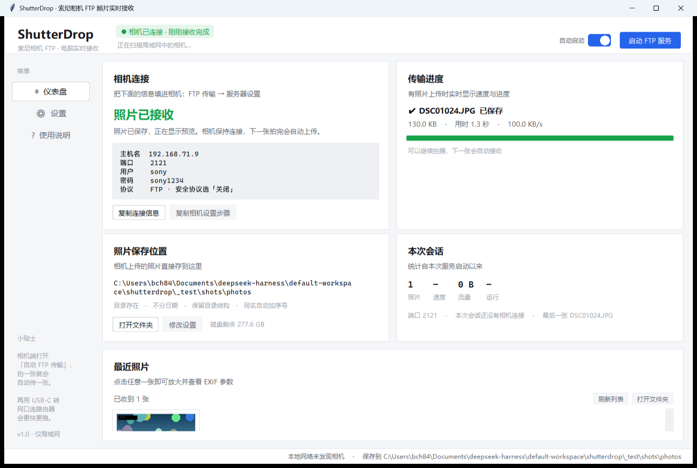
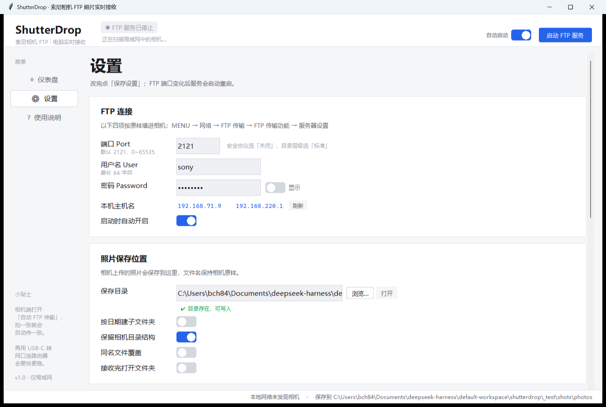
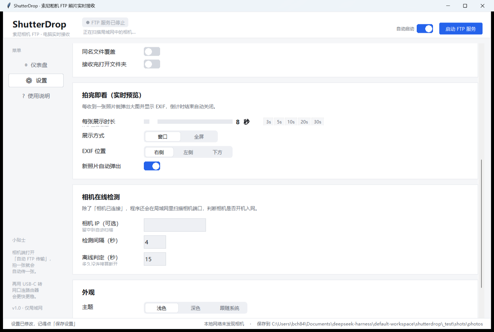
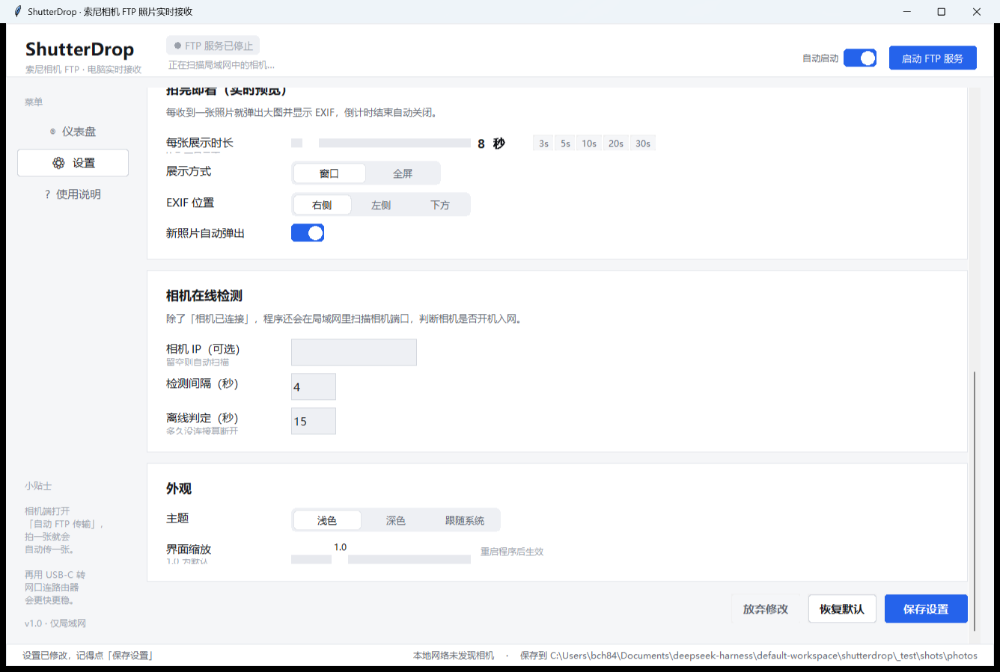

# ShutterDrop · 快门落点

<p align="center">
  
</p>

<h3 align="center">索尼相机 FTP 照片实时接收 · 拍完即看 · 自动存盘 · EXIF 一览</h3>

<p align="center">
  <a href="../../releases/latest"></a>
  
  
  
</p>

> 给索尼 **A7M4（ILCE-7M4）/ A7M5（ILCE-7M5）** 准备的拍摄现场小工具：
> 相机通过 Wi-Fi 或有线网把照片 FTP 推送到电脑，程序立即保存、弹出大图并列出 EXIF 参数，
> 展示 N 秒后自动关闭，让你拍完立刻检查构图与对焦。
> 纯 Python + Tkinter，Windows 10/11 双击即用，只在本机局域网内运行。



## 功能

| 功能 | 说明 |
| --- | --- |
| **相机是否已连接** | 顶部状态胶囊（等待 → 已连接 → 正在接收）实时反映 FTP 连接；同时扫描局域网中的相机端口（21 / 15740 / 64321），相机一开机入网就能提示 |
| **传输进度** | 文件名、百分比、已传 / 总大小、实时速度、剩余时间、队列数量 |
| **拍完即看（可设展示秒数）** | 每张照片传完自动弹出大图并在 **N 秒**后自动关闭；N 秒用滑杆设定（0 = 一直显示），支持暂停倒计时、全屏 |
| **EXIF 参数** | 相机、镜头、光圈、快门、ISO、焦距、等效焦距、曝光补偿、白平衡、分辨率、方向、GPS 等；JPEG / PNG 用 Pillow，RAW（.ARW / .DNG）用内置 TIFF 解析器，HEIF 提取内嵌预览 |
| **照片保存位置** | 任意目录、按日期分组、保留相机 DCIM 结构、同名自动加序号（绝不覆盖）、磁盘剩余空间提示 |
| 其他 | 浅色 / 深色 / 跟随系统、界面缩放、内置中文帮助页、一键复制相机设置步骤、日志 |

## 下载与安装

到 [Releases](../../releases/latest) 页面下载：

| 文件 | 说明 |
| --- | --- |
| **ShutterDrop-Portable-Windows.zip** | **推荐**。解压后双击 `启动 ShutterDrop.bat`（或 `ShutterDrop.exe`）。整个文件夹要一起保留（`ShutterDrop.App.exe` 与 `_internal` 不能少） |
| **ShutterDrop.exe** | 单文件版，复制到任何地方双击运行；首次启动解压运行库到 `%TEMP%\ShutterDrop`，约 2~5 秒 |

两个版本都带一个小启动器：启动失败会弹出**中文提示**，并把原因写入 `shutterdrop-launcher.log` / `shutterdrop.log`。

首次运行若 Windows 提示「已保护你的电脑」→ 更多信息 → 仍要运行；
若弹出防火墙提示，请勾选「专用网络」并允许访问（否则相机会连不上）。

## 一分钟上手（相机端）

1. **让相机和电脑连同一个网络**：Wi-Fi 连同一路由器；更快更稳的是 USB-C 转网口 + 网线接到同一路由器。
2. 相机 `MENU → 网络 → FTP 传输 → FTP 传输功能 → 服务器设置 → 服务器1`：

   | 相机项目 | 填写内容 |
   | --- | --- |
   | 主机名 | 程序「设置 → 本机主机名」里显示的 IP（如 `192.168.1.20`） |
   | 端口 | `2121` |
   | 安全协议 | **关闭** |
   | 用户名 / 密码 | `sony` / `sony1234`（可在程序里改） |
   | 目录层级 | 标准 |
   | 同名文件 | 不覆盖 |

3. `FTP 传输 → FTP 传输功能 → FTP 功能 → 开`，相机出现 FTP 连接图标。
4. `自动 FTP 传输 → 开`，`自动 FTP 目标 → 静止影像 → 全部`。
5. 拍照 → 电脑上自动弹出大图 + EXIF，并保存到设置的目录。

> A7M5 的服务器设置里如果有「被动模式」，请保持开启；「安全协议」保持关闭。

## 界面

| 实时预览（倒计时 + EXIF） | 设置 · FTP 与保存位置 |
| --- | --- |
|  |  |
| **设置 · 拍完即看** | **设置 · 检测与外观** |
|  |  |

- **仪表盘**：相机连接状态、要填进相机的四项参数（可一键复制）、传输进度、本次会话统计、最近照片缩略图。
- **实时预览**：`空格` 暂停 / 继续倒计时，`F` 全屏，`Esc` / `回车` 关闭。
- **设置**：FTP 连接、照片保存位置、拍完即看（展示秒数 / 窗口或全屏 / EXIF 位置）、相机在线检测、外观。
- **使用说明**：内置完整相机菜单步骤、设置项解释与常见问题。

## 从源码运行

```bash
pip install pillow            # 唯一必需的第三方库
python main.py                # 也可以用「启动 ShutterDrop.bat」双击启动
```

可选：`pip install pillow-heif` 可让 HEIF 主图（无法提取内嵌预览时）也能解码。

### 命令行参数

| 参数 | 作用 |
| --- | --- |
| `--port 2121` | 本次运行临时指定 FTP 端口（不写入设置） |
| `--photo-dir D:\Photos` | 本次运行临时指定照片保存目录 |
| `--no-autostart` | 启动后不自动开启 FTP 服务 |
| `--self-test` | 只启动 FTP 服务、不开界面（脚本联调用） |
| `--verbose` | 输出详细日志 |

日志：程序目录下的 `shutterdrop.log`（不可写时回退到 `%APPDATA%\ShutterDrop\`）。

## 项目结构

```text
shutterdrop/
├─ main.py                 启动入口（源码 / exe 共用）
├─ shutterdrop/
│  ├─ core.py              配置读写、目录与格式化工具
│  ├─ ftpserver.py         FTP 服务器（PASV/EPSV + PORT/EPRT、断点续传、安全边界）
│  ├─ detector.py          相机在线检测（端口探测）
│  ├─ exif_reader.py       EXIF 读取（Pillow + 内置 TIFF 解析）
│  ├─ imaging.py           图片解码、缩略图、HEIF 内嵌预览提取
│  ├─ app.py               业务层：状态、传输、照片库、设置应用
│  ├─ mock.py              仿真照片 / 模拟相机（测试用）
│  └─ ui/                  主题、自绘控件、主窗口、预览窗、设置页、帮助页
├─ tests/                  单元测试、端到端 FTP 测试、界面冒烟、打包验证
├─ build_launcher.py       编译 C# 启动器（MSBuild）
├─ build_exe.py            一键打包：便携文件夹版 + 单文件版
├─ prepare_build_tools.py  打包前准备依赖
├─ make_docx.py            生成使用说明书
├─ make_icon.py            生成图标
└─ .github/workflows/      GitHub Actions：打 tag 自动构建并发布 Release
```

## 开发与测试

```bash
python tests/test_unit.py        # 单元测试：配置、EXIF、HEIF、图片、检测
python tests/test_e2e.py         # 端到端：PASV / EPSV / PORT 两种顺序 / 续传 / 中文名 / 安全边界
python tests/test_ui_smoke.py    # 界面冒烟（无显示器自动跳过）
python tests/test_packaged.py    # 打包产物启动 + FTP 上传验证
```

打包（Windows）：

```bash
python prepare_build_tools.py    # 第一次打包前执行，下载 PyInstaller 等依赖
python build_exe.py              # 产物：dist_onedir/ShutterDrop-Portable、dist/ShutterDrop.exe
```

## 技术说明

- **FTP 服务器**：纯标准库实现，支持被动（PASV / EPSV）与主动（PORT / EPRT）双模式、
  断点续传（REST / APPE）、UTF-8 中文文件名、目录创建、ASCII 模式换行还原；
  只接受图片 / 视频扩展名，路径不能越出保存目录。
- **主动模式兼容**：相机在 `PORT` 之后可能先连数据端口再发 `STOR`，服务器会在回复 200 前把连接接住，
  两种顺序都能正常工作。
- **安全边界**：只监听本机网卡，不连接互联网，不执行相机发来的任何内容。

## 发布到 GitHub

仓库已经准备好 `.gitignore`、`LICENSE`、`.github/workflows/build.yml`（打 tag 自动构建并发布 Release）。
一行命令发布：

```powershell
powershell -NoProfile -ExecutionPolicy Bypass -File .\publish_github.ps1 -User 你的用户名 -Repo Sony-FTP- -PushUrl https://github.com/你的用户名/Sony-FTP-.git
```

手把手步骤见 [发布到GitHub-手把手.md](发布到GitHub-手把手.md)。

## 许可证

[MIT](LICENSE)
